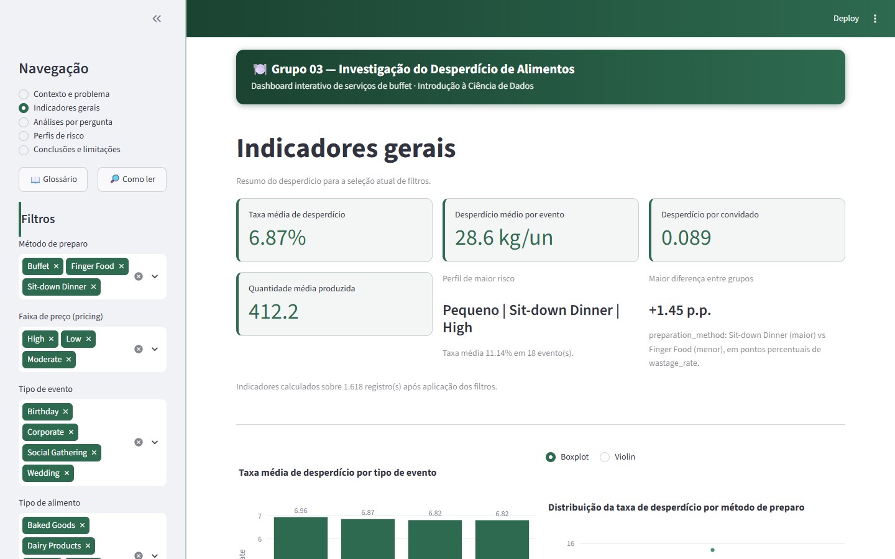
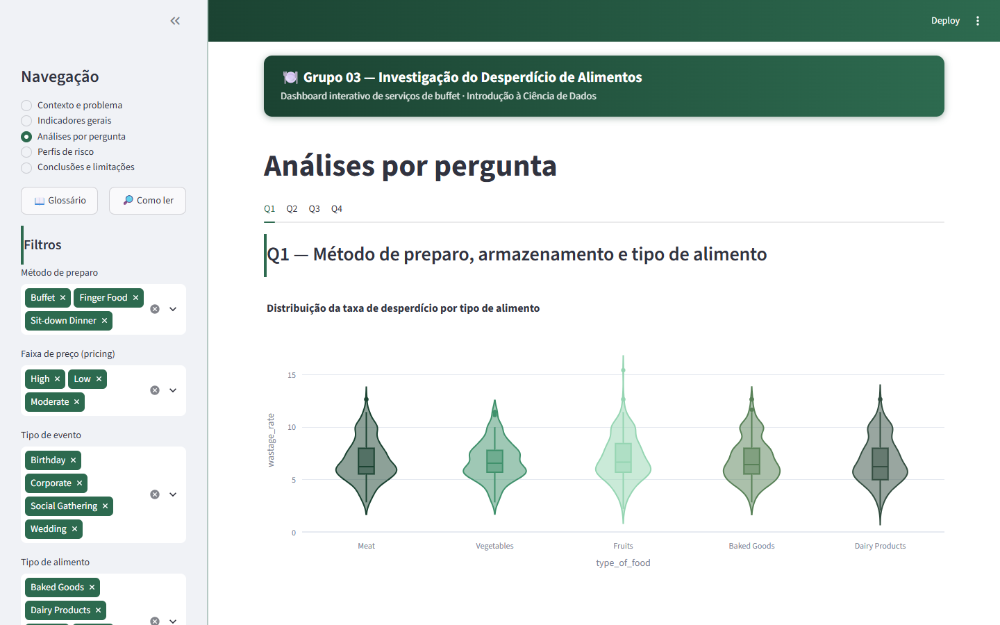

# Investigação do Desperdício de Alimentos em Serviços de Buffet

Entrega final da disciplina de Introdução à Ciência de Dados - Grupo 03.

**Integrantes:** Arthur Provenzi Parizotto, Bianca Maia Ribeiro, Emilly
Nascimento Dias e Rafael Jaques do Nascimento Lopes.





## Problema

Serviços de buffet precisam estimar, com antecedência, quanto alimento
preparar para cada evento. Errar essa estimativa gera desperdício de comida,
custo operacional e impacto ambiental. O projeto investiga **em que condições
o desperdício tende a ser maior**, para apoiar decisões de planejamento de
produção em eventos.

## Perguntas analíticas

- **Q1** - O método de preparo e as condições de armazenamento influenciam o
  volume de desperdício, considerando o tipo de alimento?
- **Q2** - Como o tipo e o porte do evento se relacionam com o desperdício?
- **Q3** - Qual a relação entre quantidade produzida, faixa de preço
  (pricing) e taxa de desperdício?
- **Q4** - Quais perfis operacionais concentram maior risco de desperdício?

## Fontes dos dados

A base original (**Food Wastage Data in Restaurant**) foi obtida no
[Kaggle](https://www.kaggle.com/datasets/trevinhannibal/food-wastage-data-in-restaurant)
e ingerida na camada bronze do pipeline (`data/bronze/food_wastage_bronze.csv`,
1782 registros). Após limpeza (remoção de 164 duplicatas completas) e
padronização, a base silver (`data/silver/food_wastage_silver.csv`, 1618
registros) alimenta a criação dos indicadores, resultando na camada gold
(`data/gold/food_wastage_gold.csv`), com 1618 eventos e 21 colunas, que é o
único insumo usado pelo dashboard e pela análise. Cada linha representa um
registro/evento de desperdício de alimentos (unidade de análise constante
em todas as camadas). Ver `data/bronze/README.md` e `data/silver/README.md`
para a rastreabilidade completa, e `notebooks/` para os notebooks originais
de limpeza, transformação e AED.

## Resumo das etapas anteriores

1. **Definição do problema e AED** - exploração inicial da base, formulação
   das perguntas Q1-Q4 e das hipóteses exploratórias HE-01 a HE-06.
2. **Preparação dos dados (Parte 3)** - organização das camadas
   bronze/silver/gold, criação dos indicadores (`wastage_rate`,
   `wastage_per_guest`, `event_profile`, `waste_risk_rank`, etc.) e validação
   automatizada da camada gold.
3. **Análise estatística (Parte 1)** - validação formal das hipóteses com
   testes estatísticos.
4. **Dashboard (Parte 2)** - aplicação Streamlit que comunica o pipeline
   completo.
5. **Reprodutibilidade e documentação (Parte 4)** - Docker, compose e este
   README.

## Ajustes realizados a partir dos feedbacks

Pareceres formativos e somativos foram recebidos em cada entrega parcial e
final. Principais ajustes incorporados:

- **Contexto e objetivo (Entrega 1):** reduzidas redundâncias do texto,
  removida a antecipação de solução, e delimitado melhor o escopo
  (unidade de análise, fonte, público-alvo). Nota final: 9/10. Ponto ainda
  em aberto e explicitamente reconhecido: o objetivo ainda cobre múltiplos
  fatores simultaneamente e algumas variáveis derivadas (`event_size`,
  `event_profile`) tinham definição operacional pouco explícita - por
  isso, a definição exata de cada faixa (quartis/tercis) e cada perfil
  está agora documentada em `docs/dicionario_indicadores.md` e nos
  notebooks de preparação.
- **Especificação do dataset (Entrega 2):** adicionada a URL completa do
  dataset no Kaggle (antes citado sem link direto), e documentada a
  unidade inferida (não confirmada pela fonte) de `quantity_of_food` e
  `wastage_food_amount`, além do reconhecimento explícito de que
  `purchase_history` e `seasonality` têm significado ambíguo na fonte -
  por isso essas colunas não são usadas como filtros ou variáveis de
  análise no dashboard. Nota final: 9/10.
- **Preparação dos dados / pipeline (Entrega 3):** o parecer elogiou a
  camada gold orientada às perguntas do projeto, mas apontou que os
  critérios de remoção de registros (1782 -> 1618) estavam pouco
  discutidos e que a unidade de análise da gold precisava ser declarada
  explicitamente. Em resposta, `data/bronze/README.md` e
  `data/silver/README.md` agora documentam o critério exato (164
  duplicatas completas removidas, 0 por ausência ou inconsistência
  lógica) e a unidade de análise (um evento por linha) é reafirmada em
  `docs/dicionario_indicadores.md` e na página "Contexto e problema" do
  dashboard. O parecer também alertou que as colunas `mean_wastage_*`
  podem gerar vazamento de informação em modelagem preditiva futura; essa
  ressalva foi documentada no dicionário de indicadores. Nota final: 9,0.
- **Análise Exploratória de Dados (AED):** o parecer somativo (nota 9,5)
  identificou dois pontos fracos: (1) o nome do notebook não seguia o
  padrão pedido (`grad_grupo_3_aed.ipynb` em vez de
  `grad_grupo_03_aed.ipynb`) - corrigido ao versionar o notebook em
  `notebooks/grad_grupo_03_aed.ipynb`; (2) alguns rótulos usavam
  linguagem mais forte que a evidência descritiva sustentava (ex.:
  "pricing como fator dominante", "efeito do armazenamento", "pricing e
  método de preparo atuam de forma aditiva"), sugerindo estrutura
  explicativa não estimada formalmente. Essa cautela terminológica foi
  aplicada de forma consistente no dashboard (Parte 2): os textos de
  leitura evitam a palavra "efeito" fora do sentido estatístico formal
  ("tamanho de efeito") e a página de conclusões caracteriza o perfil
  `Pequeno | Sit-down Dinner | High` como "perfil de maior taxa
  observada", sem atribuir uma forma funcional (aditividade) não
  demonstrada.

## Etapa de análise (Parte 1)

Script que valida as hipóteses exploratórias (HE-01 a HE-06) com testes
estatísticos formais: teste t de Welch, Kruskal-Wallis, bootstrap de
intervalo de confiança e correlação de Pearson/Spearman. Cada análise
reporta estimativa, IC 95%, valor-p e tamanho de efeito, evitando
conclusões causais (dados observacionais).

```bash
python analysis/analise_estatistica.py
```

Lê `data/gold/food_wastage_gold.csv` e gera em `outputs/analise/`:

- `resumo_analises.csv` - estimativa, IC 95%, p-valor e tamanho de efeito por análise.
- `estatisticas_grupos.csv` - estatísticas descritivas por grupo.
- `perfis_risco.csv` - ranking de perfis operacionais por taxa média de desperdício.
- `relatorio_analise.md` - relatório consolidado em markdown.

Principais achados: Sit-down Dinner desperdiça mais que os demais métodos de
preparo (7,51% vs. 6,06-7,02%, p < 0,001); pricing High é a variável isolada
mais associada ao desperdício (8,81% vs. 5,46-5,84%, p < 0,001); a diferença
de desperdício por armazenamento, observada de forma descritiva na AED para
Baked Goods e Dairy Products, **não se confirma no teste formal por
alimento** (p = 0,076 e p = 0,058, ambos acima de 0,05) - HE-02 é
classificada como rejeitada na etapa de análise; e o perfil de maior taxa
observada é `Pequeno | Sit-down Dinner | High` (~11,1%, com ressalva de
amostra pequena).

## Indicadores

Definições completas em `docs/dicionario_indicadores.md`. Principais fórmulas:

- `wastage_rate = wastage_food_amount / quantity_of_food * 100` (taxa de desperdício, em %)
- `wastage_per_guest = wastage_food_amount / number_of_guests` (desperdício por convidado)
- `event_profile = event_size | preparation_method | pricing` (perfil operacional)
- `waste_risk_rank`: ranking do `event_profile` pela taxa média de
  desperdício, em ordem decrescente (1 = maior risco).

A validação automatizada da camada gold (colunas obrigatórias, ausentes,
duplicatas, consistência lógica e fórmulas dos indicadores) está em:

```bash
python analysis/validacao_camada_gold.py   # exit code 0 = camada valida
```

Resultado detalhado em `docs/checklist_validacao_gold.md`.

## Estrutura do dashboard (Parte 2)

Aplicação Streamlit com cinco páginas:

- **Contexto e problema** - problema, público-alvo, fonte dos dados,
  escopo/unidade de análise, perguntas Q1-Q4 e amostra da base gold.
- **Indicadores gerais** - taxa média de desperdício, desperdício médio por
  evento, desperdício por convidado, quantidade média produzida, perfil de
  maior risco e maior diferença entre grupos, para a seleção atual de filtros.
- **Análises por pergunta** - uma aba por pergunta (Q1 a Q4), cada uma com o
  gráfico mais adequado (boxplot/violin, barras, heatmap, scatter ou ranking)
  e um texto curto de interpretação.
- **Perfis de risco** - ranking completo dos perfis operacionais por taxa
  média de desperdício, com tabela detalhada.
- **Conclusões e limitações** - situação de cada hipotese (confirmada,
  rejeitada ou não avaliável), com ressalvas quando aplicável, e cuidados
  de interpretação.

Filtros na barra lateral (válidos para todas as páginas, exceto "Contexto e
problema"): método de preparo, pricing, tipo de evento, tipo de alimento,
porte do evento e condição de armazenamento. Todos iniciam com todas as
opções selecionadas e o botão "Limpar filtros" restaura a seleção completa.

### Personalização visual e elementos interativos

- **Tema** (`.streamlit/config.toml`) e paleta de gráficos
  (`app/utils/palette.py`) usam a mesma família de verdes; CSS customizado
  (`app/utils/styling.py`) estiliza cartões de indicador, cabeçalhos,
  sidebar e botões.
- **Modais** (`app/components/modals.py`, via `st.dialog`): "Glossário" e
  "Como ler" na barra lateral, e "Ver detalhes" de um perfil específico na
  página *Perfis de risco* (com badge de nível de risco).
- **Controles interativos**: alternância boxplot/violin no gráfico de
  método de preparo (*Indicadores gerais*) e slider de quantos perfis
  mostrar no ranking (*Perfis de risco*).

## Estrutura do repositório

```text
.
├── app/                          # dashboard Streamlit (Parte 2)
│   ├── app.py                    # ponto de entrada
│   ├── components/               # filtros, indicadores, graficos e modais
│   ├── services/                 # carregamento e filtragem da base gold
│   └── utils/                    # formatacao, paleta de cores e CSS customizado
├── analysis/                     # etapa de analise (Parte 1) e validacao (Parte 3)
│   ├── analise_estatistica.py
│   └── validacao_camada_gold.py
├── notebooks/                    # notebooks originais das entregas parciais
│   ├── 1_cleaning.ipynb          # bronze -> silver
│   ├── 2_transformation.ipynb    # silver -> gold
│   └── grad_grupo_03_aed.ipynb   # analise exploratoria de dados (AED)
├── data/
│   ├── bronze/food_wastage_bronze.csv  # dado cru (1782 linhas)
│   ├── silver/food_wastage_silver.csv  # dado limpo/padronizado (1618 linhas)
│   └── gold/food_wastage_gold.csv      # base final usada pelo app e pela analise
├── docs/
│   ├── dicionario_indicadores.md
│   └── checklist_validacao_gold.md
├── outputs/                      # saidas geradas pelos scripts (nao versionadas)
├── Dockerfile                    # imagem do dashboard (Parte 4)
├── compose.yaml                  # orquestracao com Docker Compose (Parte 4)
├── requirements.txt              # dependencias Python
├── apresentar.ps1 / apresentar.sh  # sobe o dashboard com um comando (demo/apresentacao)
├── parar.ps1 / parar.sh            # encerra o dashboard
├── README.md
└── DIVISAO_RESPONSABILIDADES.md
```

Todos os caminhos de dados são relativos (resolvidos a partir da raiz do
repositório), compatíveis com execução local e via Docker.

## Instruções de execução

### Script rápido (recomendado para demo/apresentação)

Na raiz do repositório, execute:

```powershell
powershell -ExecutionPolicy Bypass -File apresentar.ps1   # Windows
```

```bash
./apresentar.sh                                            # Linux/Mac/Git Bash
```

O script detecta Docker automaticamente e roda `docker compose up --build
-d`; se o Docker não estiver disponível na máquina, cai para execução
local com Python. Em ambos os casos, espera o dashboard responder e abre
o navegador em `http://localhost:8501` sozinho. Para encerrar, use
`parar.ps1` (Windows) ou `./parar.sh` (Linux/Mac/Git Bash).

### Com Docker (recomendado)

Requisito: Docker com o plugin Compose. Na raiz do repositório:

```bash
docker compose up --build
```

### Sem Docker (execução local)

Requisito: Python 3.10 ou superior.

```bash
pip install -r requirements.txt
streamlit run app/app.py
```

## Endereço de acesso

Após iniciar (por Docker ou localmente), o dashboard fica disponível em:

**<http://localhost:8501>**

## Procedimento para encerramento

- **Docker (em primeiro plano):** `Ctrl+C` no terminal e, em seguida,
  `docker compose down` para remover o container.
- **Execução local:** `Ctrl+C` no terminal onde o Streamlit está rodando.

## Limitações conhecidas

- Os dados são **observacionais**: as associações encontradas (ex.: pricing
  High com maior desperdício) não permitem conclusões causais.
- Alguns perfis operacionais têm **poucos eventos** (o perfil de maior risco
  tem 18 ocorrências), tornando suas médias instáveis; esses perfis são
  sinalizados como de baixa confiança no dashboard.
- A base cobre um único conjunto de eventos obtido no Kaggle, sem
  informação de período, região ou custo monetário do desperdício, o que
  limita a generalização dos resultados.
- A correlação entre quantidade produzida e taxa de desperdício é fraca a
  moderada (r = 0,25); quantidade, isolada, não é bom preditor.
- A unidade de `quantity_of_food` e `wastage_food_amount` (assumida como
  quilogramas) é uma inferência do grupo: a fonte original não a declara.
- Os atributos `purchase_history`, `seasonality` e `geographical_location`
  têm significado operacional ambíguo na fonte e por isso não são usados
  como filtros ou variáveis de análise no dashboard.
- As colunas `mean_wastage_by_prep_method`, `mean_wastage_rate_by_food_type`
  e `mean_wastage_rate_by_profile` foram calculadas sobre toda a base; não
  devem ser usadas como features em modelagem preditiva futura sem
  recálculo restrito ao conjunto de treino (risco de vazamento de dados).
- O dataset não possui identificador único por evento; a remoção de
  duplicatas completas (164 registros, ver `data/silver/README.md`) é
  tecnicamente justificável mas não elimina a possibilidade de dois
  eventos reais terem sido registrados com os mesmos valores.

## Declaração de uso de Inteligência Artificial

O grupo utilizou a ferramenta **Claude Code (Anthropic)** como assistente de
programação durante o desenvolvimento: apoio na escrita de código do
dashboard e dos scripts de análise, na configuração de reprodutibilidade
(Dockerfile, compose.yaml) e na redação de documentação. Todo o conteudo
gerado com apoio de IA foi revisado, testado e validado pelos integrantes,
que são responsáveis pelas decisões analíticas, pela interpretação dos
resultados e pelo conteudo final entregue.

## Divisão de responsabilidades

Detalhamento completo em `DIVISAO_RESPONSABILIDADES.md`.

| Parte | Frente principal | Peso |
| --- | --- | --- |
| Parte 1 | Análise estatística e validação das hipóteses | 25% |
| Parte 2 | Dashboard Streamlit e experiência interativa | 25% |
| Parte 3 | Dados, indicadores e rastreabilidade do pipeline | 25% |
| Parte 4 | Reprodutibilidade, Docker e documentação final | 25% |

## Minha contribuição

- Desenvolvimento do dashboard interativo em Streamlit: componentes, serviços e
  utilitários da aplicação, além dos ajustes finais de interface.
- Scripts de inicialização rápida para a apresentação.
- Preparação da base gold para execução local, `requirements.txt` e atualização do
  README com a estrutura do dashboard e da análise.

> Este repositório é uma cópia, com histórico, do original do grupo no GitLab da
> UNIPAMPA (privado). Os e-mails dos colaboradores foram anonimizados no histórico.

## Repositório e submissão

```bash
git clone https://gitlab.unipampa.edu.br/ales/icd-2026.1/grupo-03.git
```

A versão submetida corresponde a tag `entrega-final`:

```bash
git checkout entrega-final
```
